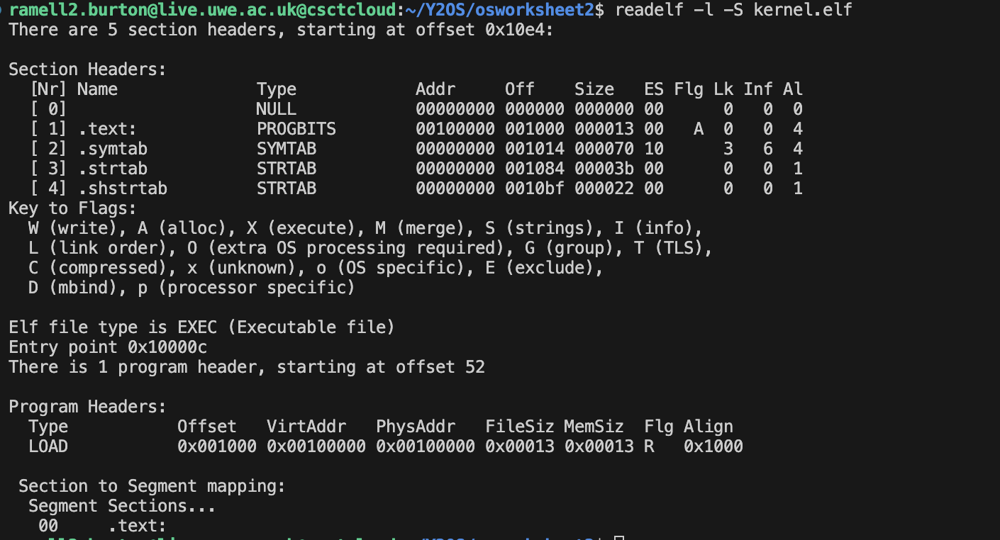
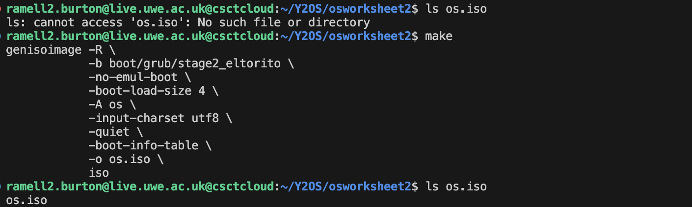
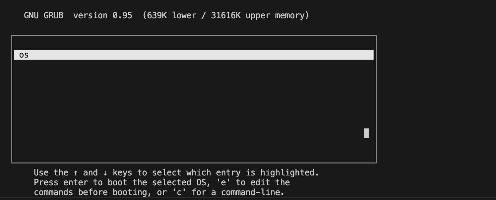
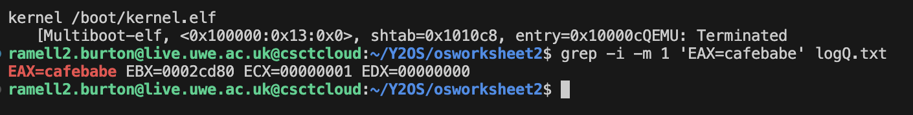
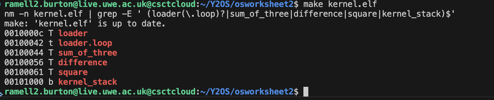
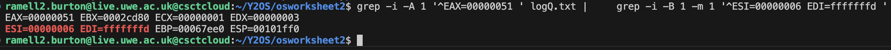
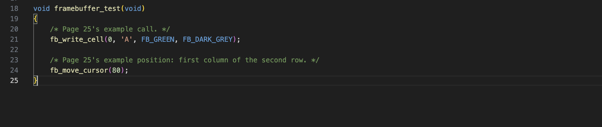
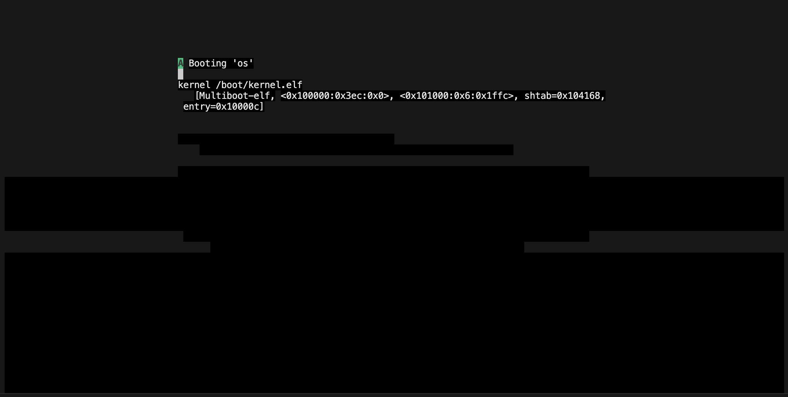
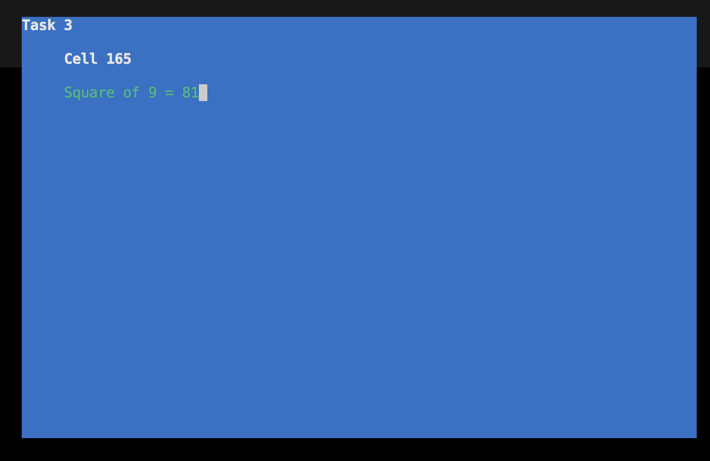
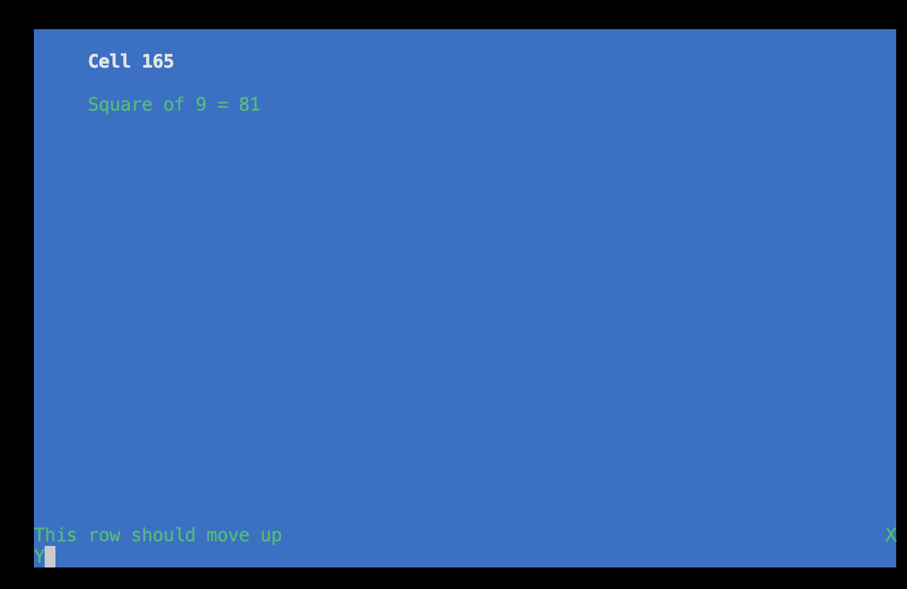

# Worksheet 2 - Operating Systems

In this worksheet I am developing a small 32-bit operating system. In part 1, I build a small kernel in assembly which is loaded by the GRUB bootloader. This kernel is then extended to call functions written in C, and then displays text on screen using a framebuffer.

A makefile automates the steps to assemble and link the kernel, and then packages it with the bootloader into a bootable iso image. QEMU is used as a virtual machine to boot the imge, where the CPU state is logged into a text file.

## Directory structure:
```text
.
├── .gitignore
├── Makefile
├── README.md
├── drivers/
├── source/
│   ├── loader.asm
│   └── link.ld
├── iso/
│   └── boot/
│       ├── kernel.elf
│       └── grub/
│           ├── menu.lst
│           └── stage2_eltorito
├── loader.o
├── kernel.elf
├── os.iso
└── logQ.txt
```
The `iso` directory contains all the files that will be packaged into the bootable disc image. `source` contains the kernel source files, such as `loader.asm`, and the linker script `linker.ld`


## Part 1

### Task 1

In Worksheet 1, my C driver called `asm_main` and received a return value when the assembly routine finished. For Task 1, GRUB loads my kernel into memory and starts running it directly. The kernel puts `0xCAFEBABE` into the `EAX` register, then enters an infinite loop. I use QEMU’s CPU log to check that execution reached my code.

#### Multiboot header

I place a Multiboot header at the beginning of the `.text` section in `source/loader.asm` so GRUB can recognise the kernel.

```nasm
MAGIC_NUMBER equ 0x1BADB002
FLAGS        equ 0x0
CHECKSUM     equ -MAGIC_NUMBER

section .text
align 4
    dd MAGIC_NUMBER
    dd FLAGS
    dd CHECKSUM
```

The magic number identifies the header, and `FLAGS` is zero because I leave the optional flags unset. GRUB checks that the magic number, flags and checksum add up to zero in 32-bit arithmetic. With the flags set to zero, the checksum is the negative of the magic number. Each `dd` writes one 32-bit value into the file, so these three fields take up 12 bytes.

GRUB expects the complete header within the first 8 KiB of `kernel.elf`, starting at a file offset divisible by four. The `align 4` directive tells NASM to insert padding if needed to put the header on a 4-byte boundary. 

#### Linking the kernel at 1 MiB

After NASM assembles `loader.asm` into `loader.o`, I use GNU `ld` with `source/link.ld` to decide where the kernel’s sections will go in memory. These are the lines that set the starting address and entry point.

```ld
ENTRY(loader)

SECTIONS {
    . = 0x00100000;

    .text ALIGN(0x1000) : {
        *(.text)
    }

    /* Other sections follow. */
}
```

The `.` in the script is the linker’s location counter. Setting it to `0x00100000` starts the kernel layout at 1 MiB, above the low-memory region used by GRUB itself, the BIOS and memory-mapped I/O. The `*(.text)` line collects the input `.text` sections from the object files into the output `.text` section.

`ALIGN(0x1000)` places the output `.text` section on a 4 KiB boundary. 

In the assembly, `global loader` makes the `loader` label visible to the linker. `ENTRY(loader)` then records the address of that label as the ELF entry point. The `.text` section starts at 1 MiB with the header, and execution starts at the `loader` label after it.

These are the commands used to assemble and link the Task 1 kernel from the repository root.

```sh
nasm -f elf source/loader.asm -o loader.o
ld -m elf_i386 -T source/link.ld loader.o -o kernel.elf
```

I can check the resulting ELF file with `readelf`. The ELF header shows the entry point, the program headers show the load addresses, and the section headers show where `.text` begins in the file.

```sh
readelf -l -S kernel.elf
```



#### Building and booting the ISO

The `Makefile` automates the build. It assembles and links the kernel, copies `kernel.elf` into `iso/boot/`, and uses `genisoimage` to package the `iso/` directory into `os.iso`. The image includes GRUB’s boot file, `stage2_eltorito`, and its configuration file, `menu.lst`.

```sh
make
make run
```
The Makefile can also be used with the `run` command which boots the OS in QEMU using `qemu-system-i386 -nographic -boot d -cdrom os.iso -m 32 \
    -d cpu -D logQ.txt`




QEMU boots the ISO as a virtual CD-ROM, and the BIOS starts GRUB from stage2_eltorito. GRUB reads menu.lst to find /boot/kernel.elf, checks its Multiboot header and uses the ELF program headers to load it into memory. It then jumps to the entry point at loader, where mov writes 0xCAFEBABE into EAX.



#### Checking the value in EAX

At `loader`, I write `0xCAFEBABE` to `EAX`. The jump then repeats indefinitely without changing the register.

```nasm
loader:
    mov eax, 0xCAFEBABE

.loop:
    jmp .loop
```

The QEMU command for this task boots `os.iso` as a CD-ROM and saves the CPU trace to `logQ.txt`. The `-d cpu` option enables CPU-state logging, and `-D logQ.txt` sets the output file.

```sh
qemu-system-i386 -nographic -boot d -cdrom os.iso -m 32 \
    -d cpu -D logQ.txt
```

After closing QEMU, I search the log for the first line containing the expected register value.

```sh
grep -i -m 1 'EAX=cafebabe' logQ.txt
```

A line containing `EAX=cafebabe` confirms that the emulated CPU executed the instruction in my kernel.




### Task 2

GRUB still loads the kernel and jumps to `loader` as in Task 1. Once `loader` starts, I set up a stack and call three functions from `source/kernel.c`. In Worksheet 1 my C driver called assembly. Here the assembly code makes the calls, passes the arguments and reads the results.

#### Setting up the stack

I use the stack setup from Chapter 3 of *The Little Book of OS Development*. In `source/loader.asm`, I reserve 4096 bytes in `.bss` and set `ESP` before the first function call.

```nasm
KERNEL_STACK_SIZE equ 4096
```

```nasm
section .bss
    align 4
    kernel_stack:
        resb KERNEL_STACK_SIZE
```

```nasm
mov esp, kernel_stack + KERNEL_STACK_SIZE
```

GRUB leaves `ESP` undefined. The kernel needs a valid stack before it can push arguments or execute `call`, which also pushes a return address. `kernel_stack` marks the low end of the reserved space. I add 4096 to point `ESP` just above that space because the x86 stack grows toward lower addresses. The first push moves `ESP` down before writing to memory.

The book’s `align 4` gives the stack block 4-byte alignment in assembly. In `source/link.ld`, `.bss ALIGN(0x1000)` places the output `.bss` section on a 4 KiB boundary. In this build `kernel_stack` is at the start of `.bss`, at `0x00101000`. The initial `ESP` is therefore `0x00102000`, which is also divisible by 16. Using `.bss` reserves the stack in memory without storing 4096 bytes of stack contents in `kernel.elf`.

#### Passing arguments and getting results back

I use Chapter 3’s `sum_of_three` example in `source/kernel.c`. My two additional functions are `difference`, which subtracts its second argument from its first, and `square`, which multiplies its argument by itself.

```c
int sum_of_three(int arg1, int arg2, int arg3)
{
    return arg1 + arg2 + arg3; /* compiler returns this int in EAX */
}
```

In `source/loader.asm`, `extern sum_of_three` tells NASM that the function is defined in another object file. I declare `difference` and `square` the same way. This is the call to `sum_of_three(1, 2, 3)`.

```nasm
sub esp, 4           ; Reserve 4 bytes of padding
push dword 3         ; Third argument
push dword 2         ; Second argument
push dword 1         ; First argument
call sum_of_three
add esp, 16          ; Remove the arguments and padding
mov esi, eax         ; Save the returned value for the QEMU trace
```

The 32-bit C calling convention passes these arguments on the stack from right to left. When the C function starts, `[ESP]` holds the return address pushed by `call`, and `[ESP+4]` holds the first argument. Each argument takes four bytes, so the three arguments and four bytes of padding use 16 bytes in total. This keeps `ESP` aligned just before `call`. The function returns its integer result in `EAX`, and `ret` removes the return address. My assembly then removes the arguments and padding with `add esp, 16`.

I save the sum in `ESI` and the difference in `EDI`. C functions preserve those registers across calls, so the earlier results are still there when `square` returns. I leave the final result in `EAX` and enter `.loop`, which keeps the values available in the CPU trace.

#### Compiling and linking the C code

I extended the `Makefile` to compile `source/kernel.c` into `source/kernel.o`. GCC uses `-m32` so the C object matches the 32-bit assembly object, and `-c` stops after compilation. The `-ffreestanding` flag tells GCC that this code runs without the usual hosted C environment, and `-fno-pie` disables position-independent executable code generation.

```makefile
source/kernel.o: source/kernel.c
	$(CC) $(CFLAGS) $< -o $@

kernel.elf: loader.o source/kernel.o source/link.ld
	ld -T ./source/link.ld -melf_i386 loader.o source/kernel.o -o kernel.elf
```

GNU `ld` links both object files and resolves the assembly calls to the C function addresses. `ENTRY(loader)` in `source/link.ld` still sets the ELF entry point. From the repository root, I build the ELF and use `nm` to check the function, stack and loop addresses.

```sh
make kernel.elf
nm -n kernel.elf | grep -E ' (loader(\.loop)?|sum_of_three|difference|square|kernel_stack)$'
```



#### Checking the results in QEMU

From the repository root, I run `make run` to build the ISO and boot it in QEMU. After the kernel reaches its loop, I exit QEMU with **Ctrl+A**, then **x**. 

```sh
make run
```

```sh
grep -i -B 2 -m 1 '^EIP=00100042 ' logQ.txt
```

| Function call | Expected result | Value in the QEMU trace |
| --- | ---: | --- |
| `sum_of_three(1, 2, 3)` | `6` | `ESI=00000006` |
| `difference(7, 10)` | `-3` | `EDI=fffffffd` |
| `square(9)` | `81` | `EAX=00000051` |

QEMU shows the registers in hexadecimal. `fffffffd` is the 32-bit representation of `-3`, and `51` in hexadecimal is `81` in decimal. 




### Task 3

In Task 2, I used the QEMU CPU trace to check the values returned by my C functions. For Task 3, I add a VGA text-mode framebuffer driver so the kernel can display text and numbers on screen. GRUB still enters the kernel at `loader` in `source/loader.asm`. After the calls to `sum_of_three`, `difference` and `square`, the loader calls `framebuffer_test()` in `source/kernel.c` using the stack from Task 2.

```nasm
    call framebuffer_test

.loop:
    jmp .loop
```

#### Writing one character to the framebuffer

The VGA text screen has 80 columns and 25 rows, giving 2000 character cells. Each cell occupies two bytes. The first stores the character and the second stores its colour attribute. In `drivers/framebuffer.c`, I use a `char` pointer to access these bytes at the start of VGA text memory.

```c
char *fb = (char *) 0x000B8000;
```

For the top-left cell, `fb[0]` holds the character and `fb[1]` holds its colour. The next cell starts at `fb[2]`, so `fb_write_cell()` takes a byte offset of `2 * n` for cell number `n`.

My first test used the two calls shown below. `fb_write_cell(0, 'A', FB_GREEN, FB_DARK_GREY)` writes `A` to the top-left cell, and `fb_move_cursor(80)` moves the cursor to the first cell of the second row.



Chapter 4’s `fb_write_cell()` example packs the two colours the wrong way round. It shifts the foreground value, green (`2`), into the background field and puts dark grey (`8`) in the foreground field. This produces `0x28`, which is why the first screenshot shows a dark `A` on a green background. I fixed this in `drivers/framebuffer.c` by shifting `bg` left four bits and keeping `fg` in the low four bits. With the same arguments, my corrected function stores `0x82`.

```c
fb[i] = c;
fb[i + 1] = ((bg & 0x0F) << 4) | (fg & 0x0F);
```



GRUB’s boot text is still visible because this first test only overwrites one cell.

#### Moving the hardware cursor

Writing a character changes the contents of screen memory. To move the visible cursor, `fb_move_cursor()` sends a **cell number** to the VGA controller. This explains why the first test passes `80` to move down one row, even though that row starts at byte offset `160` in framebuffer memory.

The controller accepts the position one byte at a time. I write `14` to port `0x3D4` to select the high cursor byte, then send its value to port `0x3D5`. I repeat this with register `15` for the low byte. For cell 80 (`0x0050`), the two data bytes are `0x00` and `0x50`.

The C driver uses `outb()`, declared in `drivers/io.h` and implemented in `drivers/io.s`, to send each byte.

```nasm
outb:
    mov al, [esp + 8]
    mov dx, [esp + 4]
    out dx, al
    ret
```

As in Task 2, `[esp]` holds the return address. The first argument at `[esp + 4]` supplies the port number, which I load into `DX`. The second argument at `[esp + 8]` supplies the data byte, which I load into `AL`. `out dx, al` sends the byte to that port, and `ret` returns to the C caller.

#### Writing a buffer and scrolling

I use `cursor_pos` to track the cell where the driver will write next. My `write(buf, len)` function writes exactly `len` characters, so `write("AB", 2)` writes `A` and `B` and leaves the cursor after `B`. For each character, `write_at()` converts the cell number to the byte offset needed by `fb_write_cell()`.

```c
fb_write_cell(pos * 2, c, foreground, background);
```

After each write, I increment `cursor_pos`. Advancing from cell 79 to cell 80 takes the next character onto the second row. Advancing from cell 1999 reaches the end of the screen, so `write()` calls `scroll()` before updating the hardware cursor.

Each row occupies `80 * 2 = 160` bytes. To scroll, I copy rows 1 to 24 up by one row, including their colour bytes. The loop works from the top down so each source row is read before it gets overwritten. I then set `cursor_pos` to cell 1920, the start of the bottom row, and fill that row with spaces in the current colours.

#### Building the driver and running QEMU

I extended the `Makefile` to compile `drivers/framebuffer.c` with GCC and assemble `drivers/io.s` with NASM. GNU `ld` links `loader.o`, `source/kernel.o`, `drivers/framebuffer.o` and `drivers/io.o` into `kernel.elf` using `source/link.ld`.

From the repository root, I build the ISO and boot it in QEMU.

```sh
make
make run
```

The `run` target now uses `-display curses`, which lets me see the VGA text screen in my terminal over SSH. It also opens the QEMU monitor on port 45454.

```sh
qemu-system-i386 -display curses -monitor telnet::45454,server,nowait \
    -serial mon:stdio -boot d -cdrom os.iso -m 32 -d cpu -D logQ.txt
```

I can close QEMU from a second terminal on the same server by running `telnet localhost 45454` and entering `quit` at the monitor prompt.

#### Adding the framebuffer functions

I declare the following functions in `drivers/framebuffer.h` so the kernel can position and print text without calculating framebuffer offsets itself.

| Function | What it does |
| --- | --- |
| `fb_move(x, y)` | Checks the coordinates, calculates the cell number as `y * 80 + x` and moves the hardware cursor. An out-of-range coordinate leaves the cursor where it was. |
| `fb_set_colour(fg, bg)` | Sets the foreground and background for subsequent writes. Cells already on screen keep their existing colours. |
| `fb_clear()` | Fills all 2000 cells with spaces in the current colours, then returns the cursor to `(0, 0)`. |
| `fb_print(text)` | Counts the characters up to `'\0'` and passes that length to `write()`. |
| `fb_print_number(number)` | Prints an unsigned integer in decimal. For `81`, it first prints `8` through a recursive call with `81 / 10`, then writes the final digit using `'0' + (81 % 10)`. |

#### Checking the output in QEMU

In `framebuffer_test()`, I first print `This text should be cleared`. I then call `fb_set_colour(15, 1)` to select white text on blue, followed by `fb_clear()`. Setting the colours before clearing gives every cell the blue background. Clearing also returns the cursor to the top-left corner, where I print `Task 3`.

```c
fb_move(5, 2);
fb_print("Cell ");
fb_print_number(165);
```

Coordinates start at zero, so column 5 on row 2 is cell `(2 * 80) + 5 = 165`. The `C` in `Cell` is therefore written at byte offset `330` and its colour at offset `331`.

I then set the foreground to `FB_GREEN`, keep the blue background and move to `(5, 4)`. I print `Square of 9 = ` and pass `square(9)` to `fb_print_number()`. The `81` on screen comes from calling my Task 2 function again and printing its return value.



For the scrolling test, I print `This row should move up` at `(0, 24)`, then move to `(79, 24)`, the bottom-right cell. A busy-wait loop briefly leaves the label visible before `fb_print("XY")` runs.

Writing `X` fills cell 1999 and advances `cursor_pos` to 2000, which triggers the scroll. The label and `X` move up together to row 23. `Y` is then written at the start of the newly cleared bottom row. The final screenshot shows `X` at the far right of the second-last row, `Y` at the bottom left and the cursor one cell to its right.




